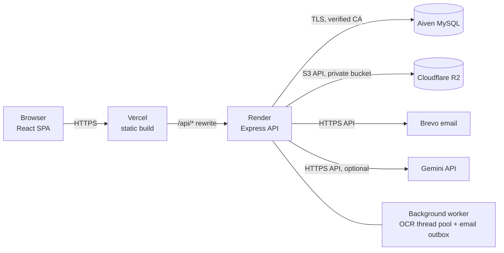

# ALU Ventures — Graduate Entrepreneurship & Funding Platform

A verified marketplace where African Leadership University (ALU) graduates present their ventures, investors and sponsors request consent-based introductions, and ALU staff run hackathons, grants and competitions.

## Live links

| What | Link |
| --- | --- |
| **Primary (custom subdomain, frontend)** | https://alufunders.nithaco.com |
| Frontend (Vercel) | https://entrepreneurs-funding-platform.vercel.app/ |
| Backend API (Render) | https://entrepreneurs-funding-platform.onrender.com |
| Walkthrough video | ADD_VIDEO_LINK_HERE |
| Technical report (PDF) | ADD_REPORT_LINK_HERE |

> **Note:** the API runs on Render's free tier. After a period of inactivity it sleeps, and the first request can take about **30–60 seconds** while it wakes up. Reload the page if the first sign-in or list takes a while. The API health check is at `https://entrepreneurs-funding-platform.onrender.com/api/health`.

---

## Contents

1. [Project overview](#1-project-overview)
2. [Scope alignment](#2-scope-alignment)
3. [Tech stack](#3-tech-stack)
4. [Technical requirements](#4-technical-requirements)
5. [Installation and local setup](#5-installation-and-local-setup)
6. [Environment variables](#6-environment-variables)
7. [Repository structure](#7-repository-structure)
8. [Architecture](#8-architecture)
9. [Security](#9-security)
10. [Testing](#10-testing)
11. [Deployment](#11-deployment)
12. [Test accounts](#12-test-accounts)
13. [Known limitations, future work and credits](#13-known-limitations-future-work-and-credits)

---

## 1. Project overview

### The problem

ALU graduates build ventures, but they have no verified, trusted place to show them to investors. Investors cannot easily tell whether a founder really graduated from ALU or whether a company is really registered. Funding opportunities (hackathons, grants, competitions) reach graduates through scattered channels. Nobody keeps a record of who was introduced to whom, or what funding resulted.

### The solution

ALU Ventures is a web platform that:

- **verifies people and ventures**: alumni email domain plus a one-time code, an uploaded ALU degree certificate, and for registered companies an RDB certificate. Automated checks read each document and label it *Likely Valid* or *Suspicious*. An administrator always makes the final decision;
- **lists approved ventures** publicly (only with the founder's consent) and for approved investors, with filters;
- **connects investors and founders through consent**: an investor requests an introduction, and contact details are shared only after the graduate accepts;
- **runs opportunities**: staff propose hackathons, grants and competitions, the administrator publishes them, graduates apply with an approved project, staff record selection decisions and results, and the administrator approves the results;
- **keeps an audit trail** of every decision, with actor, time and reason.

### Roles

| Role | How the account is created | What they do |
| --- | --- | --- |
| **Graduate** | Self-registration with an ALU alumni email, email code and degree certificate; approved by the administrator | Submit and revise ventures, answer similarity clarifications, accept or decline introductions, apply to opportunities, publish a public profile and short posts, contact the administrator |
| **Investor / Sponsor** | Self-registration with organisation, website and interests; approved by the administrator | Browse and filter approved ventures, request introductions, confirm meetings and investments, view graduate profiles and posts, report a post |
| **Administrator** | Provisioned by the seed script from environment variables (never self-assigned) | Approve accounts and projects, review document checks and similarity flags, publish opportunities, approve competition results, record investments, moderate testimonies and posts, manage the email outbox, rules and records, and view dashboards |
| **Staff** | Provisioned by the seed script (two staff accounts) | Propose opportunities, review applicants and record shortlist / selected / not-selected decisions, mark events completed, record results, and view the staff dashboard |

### Main features

- **Verified project listing**: idea or registered-company ventures, each with a unique project code (`ALU-YYYY-XXXXX`), a rule-based sector suggestion and fuzzy similarity detection against approved projects. Similar projects are flagged for a clarification and administrator review.
- **Document checks flagged for admin review**: degree, RDB and RRA documents are read with Tesseract.js OCR (PDF text layer plus OCR) and, when configured, Google Gemini. Rule-based checks cover issuer wording, registration numbers, dates and expiry, and fuzzy name matching. The result is a review aid; the administrator decides.
- **Consent-based introductions**: request, then accept or decline, then meeting and investment confirmations by both sides, then the investment is recorded by the administrator. Two-investor limit and *Fully Funded* status.
- **Hackathons, grants and competitions**: staff proposals, administrator publication, server-side eligibility checks, one application per project, staff selection decisions with reasons, completion, results with administrator approval, and funding by competition. Opportunities can also be *link only* (apply on the organiser's site).
- **Public site**: home page with live statistics, success stories (funded projects the administrator chose to show), approved testimonies, Browse ventures, public opportunities and *Verify a Project* by code.
- **Graduate public profile and posts**: an optional public image and bio, shown only with consent. Short text posts with an optional image; investors can report a post and the administrator removes it with a reason.
- **Contact / requests**: two-way threads between a user and the administrator, with screenshot attachments.
- **Dashboards**: administrator and staff dashboards with KPI cards and charts, and Activity summaries for graduates and investors. All built from aggregated counts.
- **Audit log and email outbox**: every decision is recorded, and every email goes through a persistent outbox with retries and an administrator view.
- **One-time codes (OTP)**: six-digit codes for email verification at registration and for password reset. Sign-in itself uses email and password.
- **Records management**: archive and restore accounts, projects and opportunities. Permanent delete only for rejected records, ended opportunities and emails.
- **Appearance**: light, dark or system theme per account.
- **Investor "Billing & plans"**: a "Coming soon" placeholder only; the platform takes no payments.

> **PWA:** the proposal planned an installable Progressive Web App. `vite-plugin-pwa` is listed in `client/package.json`, but it is **not configured**: there is no web manifest and no service worker. See the scope table below.

---

## 2. Scope alignment

Status is based on what the code and the automated tests actually do. FR/NFR numbers refer to the proposal (`docs/proposal.md`, §3.3).

| Planned Feature | Intended Purpose | Current Status | Evidence |
| --- | --- | --- | --- |
| FR01 Free platform access, billing placeholder | No role is charged; premium plans shown only as "Coming soon" | **Completed** | `client/src/pages/investor/Billing.jsx` · screenshot `docs/screenshots/investor-billing.png` |
| FR02 Graduate registration (alumni domain, OTP, degree, admin approval) | Only real ALU graduates get graduate status | **Partial**: the OTP is sent by email only; SMS delivery was not built because no SMS gateway was set up for the pilot. Everything else is complete | `server/src/routes/auth.js`, `server/src/services/otp.js`, `server/tests/auth.test.js`, `server/tests/uploads.test.js` · `docs/screenshots/register-graduate.png` |
| FR03 Investor registration and controlled staff provisioning | Vetted investors; no self-assigned privileged roles | **Completed** | `server/src/routes/auth.js` (`/register/investor`), `server/scripts/seed.js`, `server/tests/seed.test.js`, `server/tests/access.test.js` |
| FR04 Project submission and revision | Idea or company ventures with evidence; changes trigger renewed review | **Completed** | `server/src/routes/projects.js`, `client/src/pages/graduate/ProjectForm.jsx`, `server/tests/projects.test.js` · `docs/screenshots/project-form.png` |
| FR05 OCR-assisted RDB certificate review | Flag registration certificates as Likely Valid / Suspicious for the admin | **Completed**, extended: Gemini can be the primary reader, and Tesseract always runs as the fallback | `server/src/services/verification/documentVerifier.js`, `server/tests/verification.test.js`, `server/tests/gemini.test.js` · `docs/screenshots/admin-document-checks.png` |
| FR06 Discovery, publication and Verify a Project | Public catalogue of consented approved projects; investor filters | **Completed** (filters: sector, stage, type and country) | `server/src/routes/public.js`, `server/src/routes/investor.js`, `server/tests/publicCodes.test.js`, `server/tests/investor.test.js` · `docs/screenshots/browse-ventures.png` |
| FR07 Investor introductions | Contact details shared only after the graduate accepts | **Completed** | `server/src/routes/introductions.js`, `server/src/services/introductions.js`, `server/tests/investor.test.js` · `docs/screenshots/introductions.png` |
| FR08 Opportunity administration and applications | Staff propose, admin publishes, server-checked eligibility, one application per project | **Completed**, extended with link-only opportunities | `server/src/routes/staff.js`, `server/src/routes/opportunities.js`, `server/src/services/opportunities.js`, `server/tests/opportunities.test.js` |
| FR09 Institutional selection | Staff, not the admin, record decisions with reasons | **Completed** | `server/src/routes/staff.js` (`/applications/:id/decision`), `client/src/pages/staff/StaffSelection.jsx`, `server/tests/opportunities.test.js` |
| Competition results (added after the proposal) | Record outcomes after an event; admin approval; funding by competition | **Completed** | `server/src/routes/adminResults.js`, `server/src/services/results.js`, `server/tests/results.test.js` |
| FR10 Monitoring and audit, persistent email outbox | Timestamped actions with actor and reason; visible email failures; archive, not delete | **Completed** | `server/src/services/audit.js`, `server/src/services/mailer.js`, `server/src/services/records.js`, `server/tests/records.test.js`, `server/tests/admin.test.js` |
| FR11 Administrator dashboard | Queues, totals and platform analytics | **Completed** | `server/src/services/dashboard.js`, `server/src/services/analytics.js`, `client/src/pages/admin/AdminDashboard.jsx`, `server/tests/dashboards.test.js` · `docs/screenshots/admin-dashboard.png` |
| Staff dashboard (added) | Applications and opportunities at a glance | **Completed** | `client/src/pages/staff/StaffDashboard.jsx`, `server/tests/dashboards.test.js` · `docs/screenshots/staff-dashboard.png` |
| FR12 Password recovery | Forgot password with a single-use, expiring code; sessions invalidated | **Partial**: the code is sent by email only (no phone delivery); expiry, five attempts, single use and session invalidation are complete | `server/src/routes/auth.js` (`/forgot-password`, `/reset-password`), `server/src/services/otp.js`, `server/tests/auth.test.js` |
| FR13 Investment lifecycle and two-investor limit | Record outcomes only after both sides confirm; close discovery fairly | **Completed** | `server/src/services/funding.js`, `server/tests/investor.test.js` |
| FR14 Project verification code | Unique `ALU-YYYY-XXXXX` code; public exact-code lookup; codes never listed publicly | **Completed** | `server/src/services/categorization.js`, `server/src/routes/public.js` (`/verify/:code`), `server/tests/publicCodes.test.js` · `docs/screenshots/verify-project.png` |
| FR15 Rule-based sector suggestion | Suggest a sector from an admin-maintained keyword map | **Completed** | `server/src/services/categorization.js` (`suggestSector`), `client/src/pages/admin/PlatformAdmin.jsx` (`RulesConfig`), `server/tests/projects.test.js` |
| FR16 Similarity detection and clarification | Flag near-duplicates of approved projects; graduate clarifies; optional RRA evidence | **Completed** | `server/src/services/categorization.js` (`findSimilarProjects`), `server/src/routes/projects.js` (`/:id/clarification`, `/:id/documents`), `server/tests/projects.test.js` |
| Contact / requests (added) | Users reach the administrator and get replies | **Completed** | `server/src/routes/support.js`, `server/src/routes/adminRequests.js`, `server/tests/support.test.js` |
| Success stories and testimonies (added) | Show funded projects and approved testimonies on the home page | **Completed** | `server/src/routes/public.js`, `server/src/routes/testimonials.js`, `server/src/routes/adminHome.js`, `server/tests/home.test.js` · `docs/screenshots/home.png` |
| Graduate public profile and posts (added) | Consent-based founder profile and short updates for investors | **Completed** | `server/src/routes/graduates.js`, `server/src/routes/posts.js`, `server/tests/graduateProfiles.test.js` |
| Member Activity summaries (added) | Graduates and investors see how things are going | **Completed** | `server/src/services/memberSummary.js`, `client/src/components/member/ActivitySummary.jsx`, `server/tests/memberSummary.test.js` |
| PWA (installable app, offline caching) | Install on phones; cache public pages | **Not implemented**: `vite-plugin-pwa` is installed but not configured (no manifest, no service worker); time went to the verification and funding workflows | `client/vite.config.js`, `client/package.json` |
| OTP for sign-in | One-time codes for account security | **Partial**: codes are used for email verification and password reset; sign-in uses email and password with rate limiting, which the proposal (FR02, FR12) also describes | `server/src/services/otp.js`, `server/src/routes/auth.js` |
| NFR01 Performance (50-user load test, LCP < 3 s) | Measured response times | **Not implemented**: no load test or Lighthouse report is in the repository | n/a |
| NFR02 Security | HTTPS, hashing, HttpOnly cookies, CSRF, rate limits, neutral responses | **Completed** | `server/src/app.js`, `server/src/middleware/auth.js`, `server/src/middleware/rateLimits.js`, `server/tests/auth.test.js`, `server/tests/access.test.js` |
| NFR03 Document protection | Type, size and page limits; private storage; authorised access | **Completed**: encryption at rest is provided by the storage provider (Cloudflare R2), not by the application | `server/src/middleware/upload.js`, `server/src/services/storage/`, `server/src/services/fileDelivery.js`, `server/tests/uploads.test.js` |
| NFR04 Usability and access | Responsive layouts, labelled controls, keyboard use, ALU logo | **Partial**: responsive and accessible layouts are done; there is no service worker, so the caching rules do not apply | `client/src/layouts/`, `client/src/components/charts.jsx` |
| NFR05 Reliability and maintainability | Migrations, tests, logging, environment secrets, backups | **Partial**: migrations, schema check at boot, automated tests, safe error logging and environment secrets are done; an availability report and a backup-restore exercise are not in the repository (the managed database provides backups) | `server/src/db/migrations.js`, `server/tests/migrations.test.js`, `server/tests/resilience.test.js` |

Screenshot paths are listed in [docs/screenshots/README.md](docs/screenshots/README.md); the images are added by the author.

---

## 3. Tech stack

Versions are the exact versions resolved in `client/package-lock.json` and `server/package-lock.json`.

### Open-source libraries

**Client** (`client/`)

| Library | Version | Use |
| --- | --- | --- |
| React / React DOM | 19.3.0 | User interface |
| React Router DOM | 7.18.4 | Client-side routing |
| Vite | 8.3.2 | Dev server and build |
| @vitejs/plugin-react | 6.1.1 | React support for Vite |
| Tailwind CSS / @tailwindcss/vite | 4.3.3 | Styling |
| vite-plugin-pwa | 1.3.0 | Installed, **not configured** (see scope table) |
| lucide-react | 1.50.0 | Thin line icons |
| pdfjs-dist | 6.4.299 | In-browser PDF preview for administrators |

**Server** (`server/`)

| Library | Version | Use |
| --- | --- | --- |
| Express | 5.2.1 | HTTP API |
| Sequelize | 6.37.8 | ORM |
| mysql2 | 3.24.5 | MySQL driver |
| Umzug | 3.8.3 | Versioned migrations |
| Tesseract.js | 7.0.0 | OCR of uploaded documents |
| pdfjs-dist | 6.3.289 | PDF text layer and page rendering |
| @napi-rs/canvas | 1.0.10 | Page rendering for OCR, image resizing |
| fastest-levenshtein | 1.0.16 | Edit distance for fuzzy matching |
| Nodemailer | 10.0.13 | SMTP email transport (development) |
| @aws-sdk/client-s3 | 3.1151.0 | S3-compatible storage (Cloudflare R2) |
| bcryptjs | 3.0.3 | Password hashing |
| jsonwebtoken | 9.0.3 | Session token in an HttpOnly cookie |
| helmet | 8.3.0 | Security headers |
| express-rate-limit | 8.7.0 | Rate limits |
| cors | 2.8.6 | CORS allow-list |
| cookie-parser | 1.4.7 | Cookie parsing |
| multer | 2.4.0 | File uploads |
| zod | 4.6.5 | Request validation |
| dotenv | 18.0.5 | Environment variables |
| Jest | 30.5.2 | Test runner |
| Supertest | 7.3.1 | HTTP integration tests |
| pdf-lib | 1.17.1 | Generating synthetic sample documents |
| nodemon | 3.1.14 | Development auto-restart |

**Runtime**

| Component | Version |
| --- | --- |
| Node.js | 22.x (`"engines": ">=22 <23"`; Render `NODE_VERSION=22`; developed on 22.16.0) |
| npm | 11.7.0 (development machine) |
| MySQL | 8.4.11 (Aiven for MySQL, read with `SELECT VERSION()`) |

### Managed external services

| Service | Use |
| --- | --- |
| **Aiven for MySQL** | Managed MySQL 8.4 database over verified TLS (production and a separate `*_test` database) |
| **Cloudflare R2** | Private S3-compatible storage for documents and images (`STORAGE_DRIVER=s3`) |
| **Brevo** | Transactional email over HTTPS (`EMAIL_DRIVER=brevo`) |
| **Google Gemini API** | Optional primary document reader (`VERIFIER=gemini`, model `gemini-3.5-flash-lite`); Tesseract always runs as the fallback |
| **Vercel** | Hosts the React build and proxies `/api/*` to Render (`client/vercel.json`) |
| **Render** | Hosts the Express API (`render.yaml`, free plan) |

---

## 4. Technical requirements

| Requirement | Details |
| --- | --- |
| Node.js | 22.x (the server's `engines` field requires `>=22 <23`) |
| npm | 10 or newer (developed with 11.7.0) |
| MySQL | 8.x **with TLS**. The server always connects over TLS and verifies the server certificate against a CA file, so a MySQL that accepts TLS is required (the project uses a free Aiven for MySQL service). |
| Browsers tested | Google Chrome (desktop at 1440 × 900, and a 390 × 844 phone viewport), via automated Playwright walkthroughs and manual use |
| Development hardware | Windows 11 Pro laptop, Intel Core i5-1135G7 (4 cores, 2.4 GHz), 12 GB RAM |
| Optional | A Brevo or SMTP account to send real email; a Gemini API key; a Cloudflare R2 bucket. Without them the server uses SMTP settings, Tesseract only, and local disk storage. |

---

## 5. Installation and local setup

The steps are the same on Windows, macOS and Linux unless a command is marked otherwise. On Windows use PowerShell or Git Bash.

### 5.1 Clone

```bash
git clone https://github.com/levishimwe/Entrepreneurs_funding_Platform.git
cd Entrepreneurs_funding_Platform
```

### 5.2 Install dependencies

```bash
cd server
npm install
cd ../client
npm install
cd ..
```

### 5.3 Prepare the database

1. Create a MySQL 8 service that accepts TLS (for example a free Aiven for MySQL service) and note its host, port, user and password.
2. Download the service's CA certificate and save it as `server/certs/ca.pem`. This folder is git-ignored.
3. Create two databases: one for the app (for example `defaultdb`, which Aiven creates for you) and one for the tests, whose name **must end in `_test`** (default `alu_funding_test`). Then check the connection:

```sql
CREATE DATABASE alu_funding_test;
```

```bash
cd server
npm run db:test        # prints the MySQL version and the TLS cipher in use
```

### 5.4 Create `server/.env`

Copy the example and fill it in. Every variable is described in [section 6](#6-environment-variables).

```bash
# macOS / Linux / Git Bash
cp server/.env.example server/.env
```

```powershell
# Windows PowerShell
Copy-Item server\.env.example server\.env
```

Minimum values for local development (example values only; use your own):

```dotenv
NODE_ENV=development
PORT=4000
CLIENT_URL=http://localhost:5173
JWT_SECRET=replace-with-a-long-random-string
DB_HOST=your-mysql-host.example.com
DB_PORT=12345
DB_NAME=defaultdb
DB_USER=your-db-user
DB_PASSWORD=your-db-password
DB_SSL_CA=./certs/ca.pem
STORAGE_DRIVER=local
EMAIL_DRIVER=smtp
SMTP_HOST=smtp.example.com
SMTP_USER=you@example.com
SMTP_PASS=your-smtp-app-password
ADMIN_EMAIL=admin@example.org
ADMIN_PASSWORD=ChangeMe-Admin-2026
STAFF1_EMAIL=staff1@example.org
STAFF1_PASSWORD=ChangeMe-Staff1-2026
STAFF2_EMAIL=staff2@example.org
STAFF2_PASSWORD=ChangeMe-Staff2-2026
```

Generate a strong `JWT_SECRET` with:

```bash
node -e "console.log(require('crypto').randomBytes(48).toString('hex'))"
```

The client needs no environment variables: in development Vite proxies `/api` to `http://localhost:4000` (`client/vite.config.js`). `client/.env.example` documents the one optional variable.

### 5.5 Run migrations and seed the admin and staff accounts

```bash
cd server
npm run migrate        # applies every pending migration (also done automatically when the server starts)
npm run seed           # creates/updates the admin and two staff accounts from ADMIN_* / STAFF*_ variables
```

Passwords for seeded accounts must be at least 12 characters and include a letter and a number.

### 5.6 Start the server and the client

In two terminals:

```bash
cd server
npm run dev            # API on http://localhost:4000 (nodemon); or: npm start
```

```bash
cd client
npm run dev            # web app on http://localhost:5173
```

Open **http://localhost:5173**. Sign in with the admin account from your `.env`, or register a graduate (alumni email domain from `ALUMNI_EMAIL_DOMAINS`) or an investor. Sample synthetic certificates for testing uploads are in `server/samples/` (regenerate them with `npm run samples` in `server/`).

### 5.7 Run the tests

```bash
cd server
npm test
```

The tests use the separate `*_test` database: `tests/globalSetup.js` migrates it, empties its data tables and seeds throwaway test accounts. It refuses to run against any database whose name does not end in `_test`. Your database user also needs permission to create databases, because `tests/migrations.test.js` creates and drops its own throwaway `*_test` databases. No email is sent, Gemini is never called, and uploads go to `server/uploads-test/`.

Build the client:

```bash
cd client
npm run build          # output in client/dist
```

---

## 6. Environment variables

All variables belong to `server/.env` (locally) or the Render service (production). `render.yaml` lists the production set. Never commit real values.

| Name | Purpose | Required? |
| --- | --- | --- |
| `NODE_ENV` | `development`, `production` or `test` | Optional (default `development`) |
| `PORT` | HTTP port (Render sets it) | Optional (default `4000`) |
| `CLIENT_URL` | Allowed browser origin(s), comma-separated; the first is used in email links | Optional (default `http://localhost:5173`) |
| `JWT_SECRET` | Signs session tokens and keys the OTP hash | **Required** |
| `SESSION_HOURS` | Session length in hours | Optional (default `12`) |
| `ALUMNI_EMAIL_DOMAINS` | Email domains accepted for graduate registration | Optional (default `alueducation.com`) |
| `TRUST_PROXY` | Number of proxies in front of Express (`2` behind Vercel + Render) | Optional (default `1`) |
| `COOKIE_SECURE` | Force the cookie's `Secure` flag (`true`/`false`) | Optional (default: on in production) |
| `COOKIE_SAMESITE` | Cookie `SameSite` value | Optional (default `lax`) |
| `DB_HOST` | MySQL host | **Required** |
| `DB_PORT` | MySQL port | Optional (default `3306`) |
| `DB_NAME` | Application database | **Required** (not used in tests) |
| `DB_NAME_TEST` | Test database (must end in `_test`) | Optional (default `alu_funding_test`) |
| `DB_USER` | MySQL user | **Required** |
| `DB_PASSWORD` | MySQL password (`DB_PASS` accepted as an alias) | **Required** |
| `DB_SSL_CA` | Path to the CA certificate file | One of `DB_SSL_CA` (file exists) or `DB_CA_CERT` is **required** (default path `./certs/ca.pem`) |
| `DB_CA_CERT` | CA certificate as PEM text or base64 (used when the file is absent, e.g. on Render) | See above |
| `DB_CONNECT_TIMEOUT_MS` | TLS connect timeout | Optional (default `20000`) |
| `MIGRATE_ON_BOOT` | Apply migrations and check the schema before listening | Optional (default on, except in tests) |
| `SEED_ON_BOOT` | Sync admin/staff accounts at start-up | Optional (default on in production) |
| `STORAGE_DRIVER` | `local` or `s3` | Optional (default `local`; production `s3`) |
| `UPLOAD_DIR` | Folder for the local driver | Optional (default `./uploads`) |
| `S3_BUCKET` | Private bucket name | Required when `STORAGE_DRIVER=s3` |
| `S3_ENDPOINT` | S3 endpoint, e.g. `https://<account-id>.r2.cloudflarestorage.com` | Required when `STORAGE_DRIVER=s3` |
| `S3_REGION` | Region (`auto` for R2) | Optional (default `auto`) |
| `S3_ACCESS_KEY_ID` | Bucket access key | Required when `STORAGE_DRIVER=s3` |
| `S3_SECRET_ACCESS_KEY` | Bucket secret key | Required when `STORAGE_DRIVER=s3` |
| `S3_FORCE_PATH_STYLE` | Path-style URLs (`true`/`false`) | Optional (default `false`) |
| `EMAIL_DRIVER` | `smtp`, `brevo` or `resend` | Optional (default `smtp`) |
| `EMAIL_API_KEY` | Brevo or Resend API key | Required for `brevo` / `resend` |
| `MAIL_FROM` | Sender, e.g. `"ALU Ventures" <sender@example.org>` (must be verified with the provider) | Optional |
| `SMTP_HOST`, `SMTP_PORT`, `SMTP_SECURE`, `SMTP_USER`, `SMTP_PASS` | SMTP settings for the `smtp` driver | Required for `smtp` to deliver mail |
| `GEMINI_API_KEY` | Google Gemini key for document reading | Optional (without it, Tesseract only) |
| `GEMINI_MODEL` | Gemini model | Optional (default `gemini-3.5-flash-lite`) |
| `VERIFIER` | `gemini` or `ocr` | Optional (default `gemini` when a key is set) |
| `GEMINI_TIMEOUT_MS`, `GEMINI_CONCURRENCY`, `GEMINI_MIN_INTERVAL_MS`, `GEMINI_COOLDOWN_MS` | Gemini timeout, concurrency, spacing and back-off after HTTP 429 | Optional |
| `OCR_POOL_SIZE` | OCR worker threads (each about 150 MB) | Optional (default `1`) |
| `OCR_IDLE_MS` | Idle time before an OCR thread exits | Optional (default `60000`) |
| `ADMIN_EMAIL`, `ADMIN_PASSWORD` | The administrator account created by the seed | **Required** for the seed |
| `STAFF1_EMAIL`, `STAFF1_PASSWORD`, `STAFF2_EMAIL`, `STAFF2_PASSWORD` | The two staff accounts created by the seed | **Required** for the seed |
| `ADMIN_NAME`, `STAFF1_NAME`, `STAFF2_NAME` | Display names for the seeded accounts | Optional |
| `API_PROXY` (client, development only, set in the shell) | Where `npm run dev` proxies `/api` | Optional (default `http://localhost:4000`) |

---

## 7. Repository structure

```text
.
├── README.md                     This file
├── render.yaml                   Render Blueprint for the API (no secrets; values marked sync:false)
├── .gitignore                    Ignores node_modules, .env files, uploads, certs and build output
├── client/                       React web app (Vite)
│   ├── index.html                HTML shell, fonts and meta tags
│   ├── vite.config.js            Vite config: React + Tailwind plugins, /api dev proxy
│   ├── vercel.json               Vercel build, /api rewrite to Render, SPA fallback, asset caching
│   ├── .env.example              Documents the optional client variable (none required)
│   ├── public/                   Static files: ALU logo and home-page images
│   └── src/
│       ├── main.jsx              Entry point: mounts <App/> and imports the CSS
│       ├── App.jsx               All routes (public, graduate, investor, admin, staff)
│       ├── index.css             Design tokens (light/dark), chart colours, public-site styles
│       ├── admin.css             Admin/staff console styles (tables, pills, buttons)
│       ├── context/              AuthContext: session user, sign-in/out, theme, home path per role
│       ├── layouts/              PublicLayout, AppShell, MemberShell (graduate/investor), AdminShell (admin/staff)
│       ├── components/           Shared UI: console kit, charts, dialogs, document viewer, member widgets
│       ├── lib/                  API client, constants, status labels, project action rules
│       └── pages/                Screens: public, auth, graduate, investor, admin, staff, settings
├── server/                       Express API
│   ├── package.json              Scripts (start, dev, migrate, seed, test, …) and dependencies
│   ├── .env.example              Every server variable with placeholders
│   ├── samples/                  Synthetic degree/RDB certificates for tests and demos (fictional people)
│   ├── scripts/                  migrate, seed, db-test, sample generator, OCR warm-up, re-verify, S3 copy, Gemini trial
│   ├── src/
│   │   ├── server.js             Boot: migrate → schema check → seed → listen → background worker
│   │   ├── app.js                Express app: security middleware, CSRF header check, routers, errors
│   │   ├── config/               env.js (all settings) and database.js (Sequelize over verified TLS)
│   │   ├── db/                   Migration runner, schema check, idempotent schema helpers, safe DB error text
│   │   ├── migrations/           Versioned, additive migrations (001–008)
│   │   ├── models/               Sequelize models and associations (index.js)
│   │   ├── middleware/           auth (session, roles), errors, rate limits, upload validation
│   │   ├── routes/               One router per area (auth, projects, investor, admin, staff, …)
│   │   ├── services/             Business logic: verification, storage, mail, funding, analytics, …
│   │   └── workers/              jobs.js: background document checks and email outbox loop
│   └── tests/                    Jest + Supertest suites, global setup and helpers
└── docs/
    ├── proposal.md               Capstone proposal (requirements FR01–FR16, NFR01–NFR05)
    ├── LevisIshimwe_CapstoneProposal_Updated.docx   Proposal document
    ├── ALU_Capstone_Diagrams_Updated.drawio          Architecture, ERD, use-case and sequence diagrams
    ├── design/                   Design reference screenshots
    └── screenshots/              Screenshots referenced in the scope table (README lists them)
```

---

## 8. Architecture

The browser only talks to one origin. Vercel serves the React build and rewrites every `/api/*` request to the Express API on Render. The session cookie is therefore first-party and `SameSite=Lax`. Express enforces every rule. It stores records in Aiven MySQL, private files in Cloudflare R2, sends email through Brevo, and optionally asks Gemini to read documents. A background worker inside the same process runs the document checks (OCR runs in worker threads) and flushes the email outbox.



**Boot order** (`server/src/server.js`):

1. **Migrate**: `prepareDatabase` applies pending Umzug migrations (`server/src/db/migrations.js`).
2. **Schema check**: it then verifies that every column the code needs exists (`REQUIRED_COLUMNS`) and stops with a clear `[boot] FATAL` line if not.
3. **Seed**: in production, the admin and staff accounts are created or updated from the environment (`server/scripts/seed.js`).
4. **Listen**: the Express app starts, then the background worker (document checks and email outbox).

---

## 9. Security

- **Session in an HttpOnly cookie**: a JWT in an HttpOnly, `SameSite=Lax` cookie (`Secure` in production). The token carries the user's `token_version`, so a password change ends every other session (`server/src/middleware/auth.js`).
- **CSRF header**: every state-changing `/api` request must send `X-Requested-With: fetch`, which a cross-site form cannot set (`server/src/app.js`, `client/src/lib/api.js`).
- **Passwords** are hashed with bcrypt and never shown or set by the administrator.
- **One-time codes** are six digits from `crypto.randomInt`. They are stored only as an HMAC-SHA256 hash, compared in constant time, expire after 10 minutes, allow at most 5 attempts and work once (`server/src/services/otp.js`). Reset requests give a neutral answer.
- **Rate limits** on sign-in, code requests, uploads and project-code lookups (`server/src/middleware/rateLimits.js`).
- **helmet** security headers; authenticated API responses are sent with `Cache-Control: no-store`; private files get a narrow content security policy (`server/src/services/fileDelivery.js`).
- **Server-side role checks** on every router (`requireRole`, `requireApprovedInvestor`). A test enumerates the admin and staff routes and checks that every other role is refused (`server/tests/access.test.js`).
- **Validation**: every request body and query is validated with zod. Uploads are checked by file signature, size and page count, not by the declared type (`server/src/middleware/upload.js`).
- **Private files**: stored under random keys in a private bucket, never public or presigned, and streamed only to an authorised user.
- **Consent gating**: projects are public only with the founder's publication consent. A graduate's public image, profile and posts are visible only with their consent. Contact details are shared only after an introduction is accepted.
- **Project codes never exposed publicly**: public, investor, staff and member responses carry no project code. The public reaches a venture by id, and *Verify a Project* only confirms a code the visitor already has (`server/src/services/projectView.js`, `server/tests/publicCodes.test.js`).
- **Safe logging**: database errors are logged as class, code and message only, never SQL, values or credentials (`server/src/db/errors.js`).
- **Secrets** come only from environment variables; `.env` files and certificates are git-ignored.

---

## 10. Testing

### How to run

```bash
cd server
npm test                                   # every suite, one at a time (--runInBand)
npm test -- tests/auth.test.js             # one suite
```

### Results

Latest full run: **23 test suites, 276 tests, all passing** (`cd server && npm test`).

### Strategies

| Strategy | What is covered | Examples |
| --- | --- | --- |
| Unit | Pure functions: fuzzy matching, date and expiry parsing, code format, period windows, sample-document checks | `tests/verification.test.js`, `tests/dashboards.test.js` (periods), `tests/gemini.test.js` |
| Integration (Supertest) | Real HTTP requests through Express to the test database: registration, OTP, uploads, projects, introductions, funding, opportunities, results, records | `tests/auth.test.js`, `tests/projects.test.js`, `tests/investor.test.js`, `tests/results.test.js` |
| Functional / role-based | Every admin and staff route refuses other roles; each role sees only its own data; no codes, emails or phones leak | `tests/access.test.js`, `tests/publicCodes.test.js`, `tests/memberSummary.test.js`, `tests/graduateProfiles.test.js` |
| Deployment and resilience | CA certificate loading, S3 driver, HTTPS email providers, cookie flags, health check, migrations on a fresh and an old schema, clean errors when the database fails | `tests/deploy.test.js`, `tests/migrations.test.js`, `tests/resilience.test.js` |
| Usability / responsive checks | Automated Playwright walkthroughs in Chrome at 1440 × 900 and 390 × 844 (no sideways scrolling, menus, dark mode, charts, tooltips), plus manual review | Run during development; screenshots in `docs/screenshots/` |
| Compatibility | Chrome desktop and a phone viewport; light and dark themes | Manual and automated walkthroughs |

### Known limitations

- The tests use a remote Aiven database, so each query crosses the internet. A full run takes about an hour, and a suite occasionally fails with `Exceeded timeout` or `ETIMEDOUT`. Rerunning that suite normally passes.
- Gemini, email delivery and S3 are faked in tests; no real external call is made.
- Browser checks were automated with Playwright during development but are not part of `npm test`.
- Only Chrome was tested; Firefox and Safari were not.

---

## 11. Deployment

| Part | Platform | How |
| --- | --- | --- |
| Client | **Vercel** | Project root `client/`, framework Vite, build `npm run build`, output `dist`. `client/vercel.json` rewrites `/api/:path*` to `https://entrepreneurs-funding-platform.onrender.com/api/:path*` and sends every other path to `index.html`. |
| Custom domain | **alufunders.nithaco.com** | Added to the Vercel project, so the same build and the same `/api` rewrite serve it. |
| API | **Render** | `render.yaml` Blueprint: root `server/`, build `npm ci && npm run ocr:warm`, start `npm start`, health check `/api/health`, auto-deploy on push. Secrets are entered in Render's Environment tab (`sync: false`). |
| Database | **Aiven for MySQL** | MySQL 8.4 over TLS; the CA certificate is given to Render in `DB_CA_CERT`. Migrations run automatically on every boot. |
| Files | **Cloudflare R2** | `STORAGE_DRIVER=s3` with a private bucket; files are streamed through the API only. |
| Email | **Brevo** | `EMAIL_DRIVER=brevo` (HTTPS; Render's free tier blocks SMTP ports). |
| Document AI | **Google Gemini** | `VERIFIER=gemini` with `GEMINI_API_KEY`; set `VERIFIER=ocr` to send nothing to Google. |

After deploying, check `https://entrepreneurs-funding-platform.onrender.com/api/health`. It reports `ok`, the database state and which storage and email drivers are active, never hostnames or secrets.

---

## 12. Test accounts

No passwords are published in this repository. To try the administrator, staff, graduate or investor views on the live site, **please request test credentials from the author**, Levis Ishimwe. You can also register your own graduate account (an ALU alumni email is required) or investor account; an administrator then approves it.

---

## 13. Known limitations, future work and credits

### Known limitations

- No PWA: no web manifest or service worker, so the app cannot be installed or used offline.
- One-time codes are delivered by email only (no SMS or phone).
- The free Render instance sleeps when idle (about 30–60 s to wake), and has 512 MB of memory, so OCR runs one document at a time.
- Automated document checks are a review aid. They can mislabel unusual layouts, and the administrator decides every case.
- No load test or Lighthouse report is included (NFR01).
- Staff see aggregated data across all opportunities, not only the ones they proposed.
- EXIF orientation is not applied when public images are resized.
- Gemini's free tier may let Google use submitted files to improve its products; use `VERIFIER=ocr` where that is not acceptable.

### Future work

- Configure `vite-plugin-pwa` (manifest, service worker that caches public pages only).
- SMS delivery of codes, and two-factor sign-in.
- Load testing, performance budgets and an availability report.
- A backup-restore exercise documented for the pilot.
- Payments for premium investor plans, if ALU decides to offer them.

### Author and supervisor

- **Author:** Levis Ishimwe
- **Supervisor:** David Neza Tuyishimire

### Licence

No open-source licence is granted. This repository is submitted as academic coursework at African Leadership University; all rights are reserved by the author. Contact the author before reusing the code. The ALU logo is used with the institution's approval for this project only.
